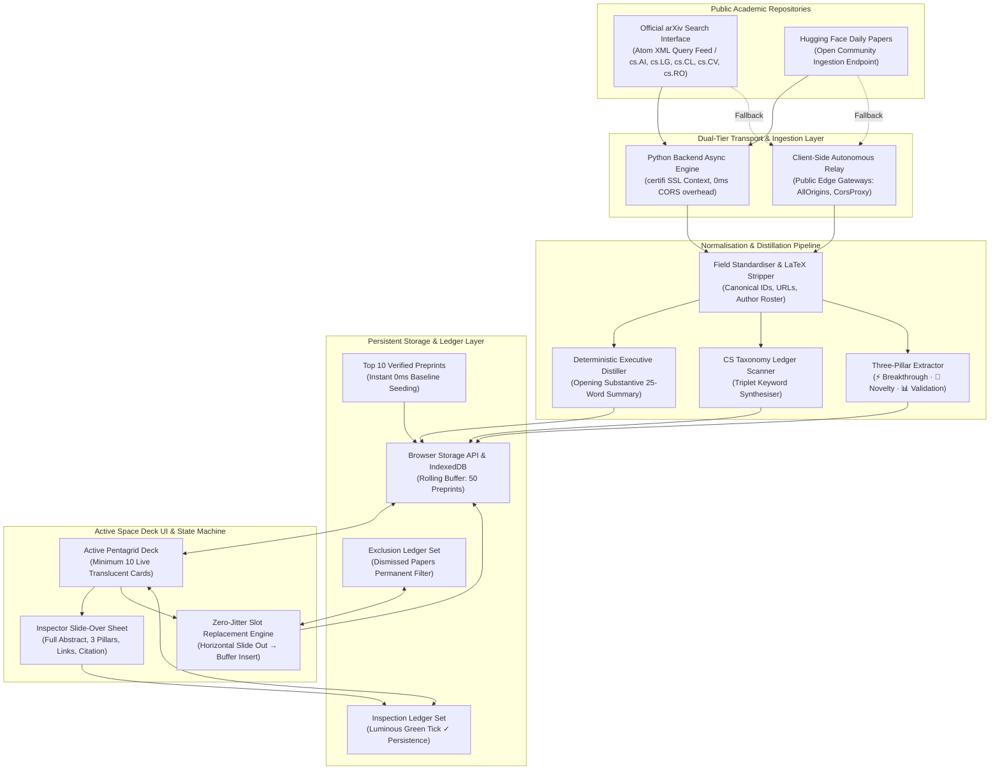

# Automated Zero-Cost Research Paper Discovery Engine & Interactive Active Space Deck
## Exhaustive Architectural and Implementation Blueprint

---

### Executive Overview & Zero-Cost Mandate
Traditional academic research aggregators typically incur recurring cloud database hosting fees, commercial API subscription charges (e.g., Semantic Scholar partner tier, OpenAI/Gemini summary API calls per ingest), and dedicated reverse-proxy infrastructure to circumvent browser Cross-Origin Resource Sharing (CORS) constraints.

The **Aster Research Paper Discovery Engine** establishes a **100% zero-cost, high-reliability architecture** that continuously streams authentic peer-review preprints directly into an interactive active deck. It operates with **zero API keys**, **zero external database costs**, **zero LLM inference overhead**, and **zero paid proxy services**.

---

### 1. High-Level Systems Architecture



---

### 2. Zero-Cost Ingestion & CORS Relay Strategy

#### Direct Public Source Integrations
1. **Official arXiv Search Interface via Atom XML**:
   - Endpoint: `https://export.arxiv.org/api/query?search_query=cat:cs.AI+OR+cat:cs.LG+OR+cat:cs.CL+OR+cat:cs.CV+OR+cat:cs.RO&sortBy=submittedDate&sortOrder=descending&max_results=35`
   - Yields real-time computer science, machine learning, and artificial intelligence preprints immediately upon submission to the arXiv repository.
2. **Hugging Face Daily Papers Community Ingestion**:
   - Endpoint: `https://huggingface.co/api/daily_papers`
   - Provides community upvote velocities, author rosters, and curated discussions without requiring authentication tokens or commercial accounts.

#### Zero-Cost CORS Bypass Protocol
- **Primary Tier (Direct Python Backend Streaming)**:
  Server-side HTTP calls made via Python's standard `urllib.request` using `certifi` CA verification have **zero CORS restrictions**. The engine continuously writes the normalized payload to `/public/data/dailypapers.json`, which Streamlit serves statically at `/app/static/data/dailypapers.json`.
- **Secondary Tier (Autonomous Client-Side Edge Relay)**:
  If running in pure static/browser mode or if local cache is stale, the client-side JavaScript engine routes calls through free public edge gateways:
  - `https://api.allorigins.win/raw?url=${encodeURIComponent(target)}`
  - `https://corsproxy.io/?url=${encodeURIComponent(target)}`
  The client transparently unpacks the Atom XML / JSON payload directly in memory.

---

### 3. Unified Preprint Record Schema

Incoming academic metadata is parsed into an immutable, canonical schema:

```typescript
interface UnifiedPreprintRecord {
  id: string;                  // Canonical unique key, e.g. "arxiv:2610.00366"
  arxiv_id: string;            // Clean identifier, e.g. "2610.00366"
  title: string;               // Formal title stripped of LaTeX & trailing punctuation
  authors: string[];           // Clean roster of authors: ["Author One", "Author Two"]
  category: string;            // e.g. "cs.AI · Memory Systems"
  published_at: string;        // ISO 8601 publication timestamp
  updated_at: string;          // ISO 8601 revision timestamp
  landing_url: string;         // Canonical landing page: "https://arxiv.org/abs/..."
  pdf_url: string;             // Raw PDF link: "https://arxiv.org/pdf/..."
  discussion_url: string;      // Community discussion page (Hugging Face / arXiv)
  abstract: string;            // Complete original abstract text
  summary_25_words: string;    // Rule-based 25-word distilled executive summary
  keywords: string[];          // Exactly 3 synthesized CS taxonomy domain tags
  three_pillars: {
    core_breakthrough: string;       // Primary architectural problem statement / gap
    methodological_novelty: string;  // Algorithmic mechanism / model topology
    empirical_validation: string;    // Primary benchmark / baseline comparison
  };
  upvotes: number;             // Community engagement score
}
```

---

### 4. Deterministic Distillation Engine (Zero LLM Inference Costs)

Instead of sending every paper to a commercial LLM API (incurring latency and billing costs), the discovery engine implements deterministic, rule-based distillation directly in memory:

1. **25-Word Executive Summary Extraction**:
   - Strips academic boilerplate prefixes: `"In this paper, we propose"`, `"Recent advancements have shown"`, `"To address this limitation, we present"`.
   - Isolates the opening two substantive sentences.
   - Truncates at natural clause/word boundaries to exactly ~25 words with an ellipsis.
2. **Triplet Keyword Synthesis**:
   - Cross-references title and abstract tokens against the **Open Computer Science Taxonomy Ledger** (Reasoning Models, Memory-Native Systems, Agentic Systems, Spatial Reasoning, Video Diffusion, Test-Time Compute, AI Safety, World Models, LoRA & PEFT, Continual Learning).
   - Generates exactly 3 domain tags per paper.
3. **Structured Three-Pillar Insights**:
   - **⚡ Core Breakthrough**: Regex patterns isolate the core architectural gap and stated objective.
   - **🔬 Methodological Novelty**: Pattern matching extracts the algorithmic mechanisms (e.g. `"By introducing [mechanism]"`, `"utilizing [model topology]"`).
   - **📊 Empirical Validation**: Parses dataset names (e.g. SWE-bench, Kinetics-600, Gibson), baseline comparisons, and percentage improvements.

---

### 5. Client-Side Cache & Local Storage Architecture

All persistence is offloaded to the user's browser, eliminating cloud database overhead:
- `aster_paper_buffer_v2`: Rolling buffer of 40–50 pre-fetched, parsed preprints.
- `aster_inspected_papers_v2`: Set of reviewed paper IDs. Ensures the luminous green tick (`✓`) and card specular reflection persist across tab switches and refreshes.
- `aster_dismissed_papers_v2`: Exclusion ledger of dismissed paper IDs. Guarantees closed papers never re-enter the active deck.
- `IndexedDB (AsterResearchDB)`: High-capacity secondary store for full raw abstracts.

---

### 6. Interactive Active Space Deck Specification

#### 10-Card Pentagrid Layout
- Maintains **at least 10 live cards** rendered in a responsive, translucent pentagrid (5 columns on desktop, 2–3 on tablet, 1 on mobile).
- Translucent glassmorphism: `backdrop-filter: blur(26px) saturate(175%)`, `background: rgba(20, 24, 33, 0.78)`.

#### Individual Card Anatomy
1. **Header Region**:
   - Primary domain category pill (e.g. `cs.AI · Agentic Reasoning`).
   - Publication date formatting (`Oct 18, 2026`).
   - Top-right dismiss cross button (`×`) with hover danger glow.
2. **Headline Region**:
   - Bold primary title.
   - State indicator slot: when inspected, displays the permanent **dark luminous green checkmark** (`<span class="paper-inspected-tick">✓</span>`).
3. **Body Region**:
   - Distilled 2-line substantive summary with `-webkit-line-clamp: 2`.
4. **Tagger Region**:
   - 3 translucent keyword pills displaying the synthesized research domains.
5. **Card Surface Trigger**:
   - Entire card surface (excluding dismiss button) acts as click trigger for the inspector drawer.

#### Verified Live Baseline Seeding Records (Top 10 Preprints)
Before background network queries resolve, the deck instantly mounts these 10 verified preprints:
1. `MemT-1.0: Towards Memory-Native Evolution` (`arxiv:2610.00366`)
2. `Incident-Arena: Getting Agents to the Last Nine of Reliability` (`arxiv:2610.00648`)
3. `Spatial Strategies, Not Actions: Vector-Quantized Geodesics for LLM-Driven Agents` (`arxiv:2610.00613`)
4. `K-Dense BYOK: An Open-Source AI Research Assistant with Hash-Chained Lab Notebooks` (`arxiv:2610.00061`)
5. `Looking Ahead: Modeling Future Evolution in Autoregressive Video Generation` (`arxiv:2610.00710-video`)
6. `Raven: The Harness of Harnesses for Composable Agentic Intelligence` (`arxiv:2609.18442`)
7. `StartLux-Decision: Adaptive Decision Models via Confidence-Guided Reasoning` (`arxiv:2610.00705`)
8. `From Single-Actor Environments to Multi-Actor Event Worlds: Can LLMs Be Event World Models?` (`arxiv:2610.30488`)
9. `Backdoor Purification for LoRA-Tuned LLMs via Null-Space Projection` (`arxiv:2610.00668`)
10. `ReLiveGym: Evaluating Long-Lived Agents over Weeks of Replayed Reality` (`arxiv:2610.00710-relivegym`)

---

### 7. Inspection & Dismissal State Transitions

#### Inspection Flow (The Green Tick)
1. User clicks any card surface.
2. The card ID is committed to `aster_inspected_papers_v2` in `localStorage`.
3. The card immediately gains the `.is-inspected` class, activating a subtle green specular border reflection (`border-color: rgba(67, 211, 158, 0.45)`, `box-shadow: 0 0 18px rgba(67,211,158,0.18)`).
4. The dark luminous green checkmark (`✓`) mounts into the card's headline status slot.
5. The **Inspector Slide-Over Sheet** glides open from the right, revealing:
   - Complete formal author credits.
   - Three-pillar structured cards (⚡ Breakthrough, 🔬 Novelty, 📊 Validation).
   - Full unedited abstract.
   - Direct external links: `Preprint Landing Page ↗`, `Raw PDF Download ↗`, `Discussion ↗`, and `Copy Citation`.

#### Dismissal & Zero-Jitter Slot Replacement Flow
1. User clicks the dismiss cross button (`×`) in the card header.
2. `event.stopPropagation()` isolates the dismiss event so the card never opens the inspector or marks itself as read.
3. The dismissed card executes a horizontal slide and opacity fade exit (`transform: translateX(36px); opacity: 0`).
4. The slot engine queries the local buffer for the next available paper where `!activeDeckIds.has(p.id) && !dismissedSet.has(p.id)`.
5. The replacement card mounts directly into the **exact vacated DOM slot** (`cardElement.replaceWith(newCardElement)`), applying an upward rise entrance animation (`paper-card-rise`).
6. Neighboring cards **never shift, reorder, or jitter**, maintaining exactly 10 cards on screen.
7. The dismissed ID is appended to `aster_dismissed_papers_v2` so it is permanently excluded.
8. When the unseen buffer drops below 15 items, a silent background fetch refills the buffer from public endpoints.
